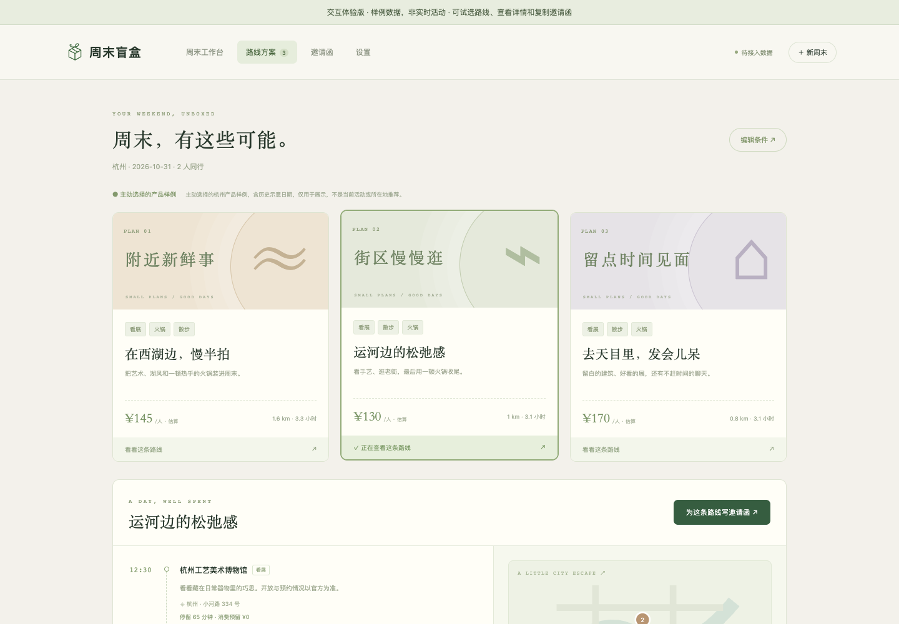
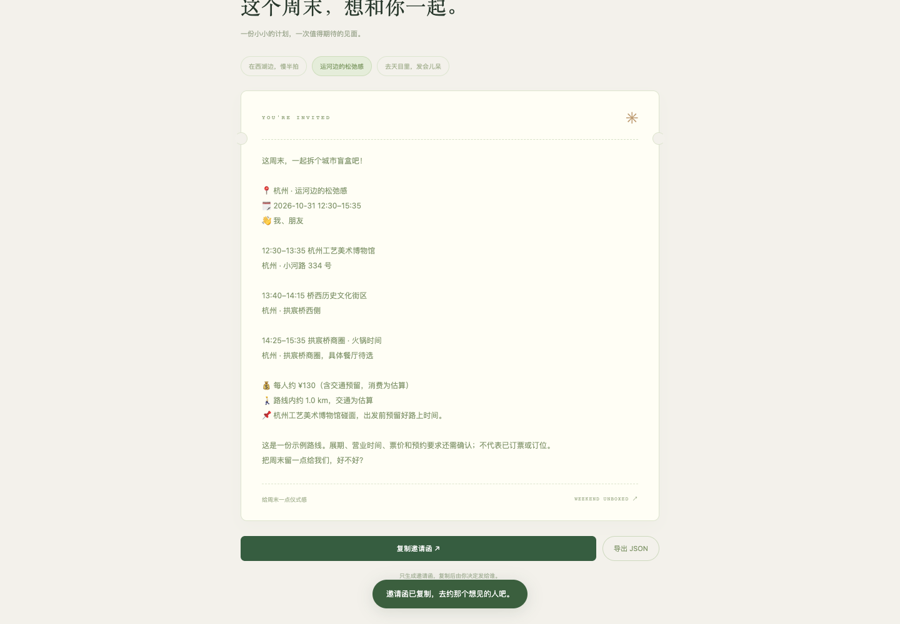
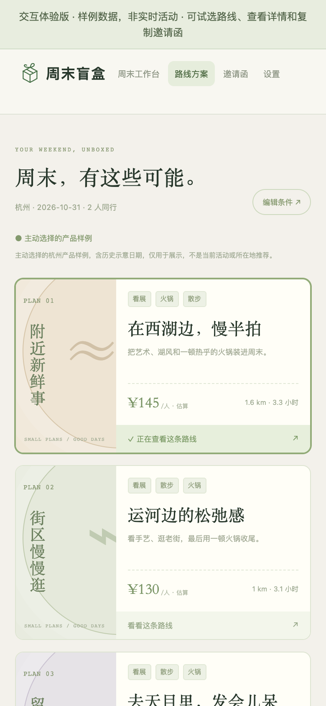

# 项目联网验证报告

**结论：公网样例交互已上线，完整前后端源码已公开；真实活动检索链路尚未上线。**

当前阶段保留产品 Demo，暂不推进云端后端部署。下文是 2026-11-06 的一次完整验证快照，末尾真实接通条件作为后续参考；产品阶段规划见 [项目介绍与后续计划](product-overview.md)。

- 体验地址：[周末盲盒](https://ngjason0428.github.io/weekend-local-agent/)。
- 源码：[ngjason0428/weekend-local-agent](https://github.com/ngjason0428/weekend-local-agent)。
- 被验证的应用提交：[`b7c050c`](https://github.com/ngjason0428/weekend-local-agent/commit/b7c050c87b526da20343005956531710797a727d)（验证时 Pages 上线的版本）。
- 本地受控测试与构建：2026-11-06，Python 3.12 / Node 26。
- 公网 HTTP 验证：2026-11-06 16:07（北京时间）。
- 公网浏览器验证：2026-11-06 16:07（北京时间），本机 Chrome 无头模式。

这里的“联网”指对已发布 HTTPS 网站实际访问、下载资源并执行交互。未将受控响应、离线杭州样例或地图适配器的存在，计作真实活动 API 联网成功。

## 一、已发布内容

| 项目 | 当前结果 | 证据 / 入口 |
| --- | --- | --- |
| GitHub 完整源码 | 公开 `main`，包含前端、Python 后端、Schema、提示词、适配器、测试和云配置 | [仓库](https://github.com/ngjason0428/weekend-local-agent) |
| GitHub Pages | 构建与发布成功 | [部署运行](https://github.com/ngjason0428/weekend-local-agent/actions/runs/42184525066) · [pages-application.json](evidence/pages-application.json) |
| 后端测试 / 前端构建 / 平台打包 | GitHub Actions 成功，59 项后端测试覆盖规则、约束和受控接口响应 | [CI 运行](https://github.com/ngjason0428/weekend-local-agent/actions/runs/42184525046) · [ci-application.json](evidence/ci-application.json) |
| 本地复验 | 本机 59 项测试通过，前端 `tsc` + `vite build` 成功，ModelScope 上传目录生成成功 | 见「四、代码和受控测试验证范围」 |
| 公网 HTTP | 首页及 JS、CSS 返回 200，类型正确；7 项检查通过 | [public-http.json](evidence/public-http.json) |
| 样例输出契约 | 三套路线，模式 `demo`，响应与路线 Schema 均通过 | [公网样例](https://ngjason0428.github.io/weekend-local-agent/sample-response.json) |
| 桌面 / 手机交互 | 9 项检查通过；1440px / 390px 共 6 个页面状态无横向溢出，脚本错误 0 | [public-browser.json](evidence/public-browser.json) |
| 源码包与平台包 | 打包脚本可用；本仓库暂未发布 GitHub Release | [Releases](https://github.com/ngjason0428/weekend-local-agent/releases) |

工作流状态可以在仓库 Actions 中继续查询。上表成功运行和 JSON 是本次已完成检查的快照，不是对未来服务可用性的保证。

## 二、实际完成的公网交互

| 测试 | 操作与实际结果 |
| --- | --- |
| 首次打开 | HTTPS 200；城市输入框为空，没有默认城市；顶部明确标注“交互体验版 · 样例数据，非实时活动” |
| 非杭州居民 | 确认常住城市“成都”并发出看展请求：条件栏保留成都，回复说明真实活动检索尚未接通；路线数为 0，没有自动给杭州推荐 |
| 主动体验样例 | 点击“体验杭州示例”，载入三套杭州样例（杭州 · 2026-10-31 · 2 人同行） |
| 方案切换 | 依次选择三条路线，详情标题随之切换；页面保留历史示意日期说明 |
| 邀请函 | 选“运河边的松弛感”后生成邀请函，文案与该路线的样例邀请函完全一致 |
| 复制 | 点击复制，页面提示“邀请函已复制”，剪贴板内容与邀请函一致 |
| JSON 导出 | 下载 `weekend-agent.json`，可解析，`schema_version=1.0`，包含三条路线 |
| 手机 | 390 × 844 下可从首页拆样例盲盒并查看三条路线；无横向溢出 |
| 网络行为 | 整个样例流程没有发出 `/turn` 或 `/api/*` 请求；没有伪造正在进行真实搜索 |

原始浏览器结果保存在 [public-browser.json](evidence/public-browser.json)，由 [`scripts/verify_public_browser.mjs`](../scripts/verify_public_browser.mjs) 生成。截图来自已发布网页，不是设计稿；地点、价格和日期是产品样例。

### 首页


### 路线与详情



### 邀请函



### 手机



## 三、尚未完成的真实联网

| 服务 / 能力 | 代码状态 | 当前线上状态 |
| --- | --- | --- |
| FastAPI `/turn` / `/api/config` / `/health` / `/ready` | 后端已实现，受控测试通过 | Python 云服务未发布；Pages 上 `/api/config`、`/health`、`/ready` 本次实测均为 404 |
| 高德地理编码 / POI / 定位 | 适配器已实现 | 无有效运行配置，未完成真实调用 |
| Tavily 官方 / 本地生活公开检索 | 分渠道搜索、来源对齐和降级已实现 | 无有效运行配置，未完成真实调用 |
| 小红书等平台 | 公开索引线索搜索入口；可接授权 feed | 未接完整内容 API，也未验证本周末覆盖率 |
| 结构化活动供给 | JSON Schema、HTTPS / 文件接入、日期与城市过滤已实现 | 尚无已配置并维护的真实活动供给 |
| 协调模型 | OpenAI 兼容接口、结构校验、重试与规则降级已实现 | 可无模型运行规则；真实模型联调未完成 |
| 城市场次 / 营业时间 / 实际交通 | 未完整实现 | 不能声称推荐已满足场次、余票、营业或真实公交时间 |

因此，**现在可以体验界面和样例操作；不能输入任意城市后获得已经核实的当周活动路线。**

## 四、代码和受控测试验证范围

59 项后端测试在本机（Python 3.12）和 GitHub Actions 上均通过，验证了：多人时间交集、预算与往返预留、总预算折算、具体周日优先、人数上限、歧义追问、否定订票语义、固定 JSON、多轮会话、隔离与错误恢复；另外验证了地图适配、城市定位确认、供给日期过滤、费用冲突、渠道去重、异城过滤和服务故障降级。

外部地图、模型、活动源在这些测试中使用受控响应。它们说明程序行为可预测，不说明真实活动覆盖、真实检索成功率、延迟或付费成本。测试内容见 [tests/](../tests/)，线上 CI 见 [运行记录](evidence/ci-application.json)。

## 五、如何复验

本地受控测试与构建：

```bash
python -m pip install -r space/requirements.txt
python -m unittest discover -s tests -v
(cd frontend && npm ci && npm run build)
python scripts/build_space.py
```

公网 HTTP 检查（无需本地服务）：

```bash
python scripts/verify_public_site.py \
  --base-url https://ngjason0428.github.io/weekend-local-agent/ \
  --output build/evidence/public-http.json
```

命令验证首页、资源、明确样例标签、JSON 契约，并单独记录公开后端路径状态。不请求供应商接口，不消耗它们的 API 配额。

公网浏览器检查（使用本机已安装的 Chrome，需先在脚本可解析的位置安装 `playwright-core`）：

```bash
node scripts/verify_public_browser.mjs \
  https://ngjason0428.github.io/weekend-local-agent/ <被验证的提交 SHA> \
  build/evidence/public-browser.json build/screenshots
```

也可在 [Verify public website 工作流](https://github.com/ngjason0428/weekend-local-agent/actions/workflows/verify-public.yml) 中点 **Run workflow**。检查完成后下载 `public-website-evidence` Artifact。该工作流是手动复验入口，不承诺后台持续监控。

手动交互复验：打开网址 → 确认没有默认城市 → 填自己的城市 → 检查未配置提示 → 主动选择杭州样例 → 切换路线 → 生成并复制邀请函 → 导出 JSON → 手机宽度重试。

## 六、后续接通真实活动的完成条件（当前暂缓）

1. 部署 Python 单实例云服务，确认 `/health` 可访问。
2. 设置高德 Key，以及 Tavily Key 或有有效记录的活动 feed。模型是可选项；Key 放云后端 Secrets。
3. 确认 `/ready` 配置检查通过，再真正调用接口，核对工具状态、来源日期和场馆。
4. 配置 Pages 的 `AGENT_API_URL` 和后端 CORS；重新发布前端。
5. 至少两个真实城市各跑通一条有日期、有来源、可出发的路线；覆盖无结果、接口失败和换城市。
6. 补具体场次 / 营业时间、实际交通、路线多样性和短时偏好，再将状态改为“真实活动版”。

配置方法见 [云端部署](../GitHub部署.md)，模块入口见 [架构与代码框架](architecture.md)，信息可信度见 [信息接入与整合](../信息接入与整合.md)。
